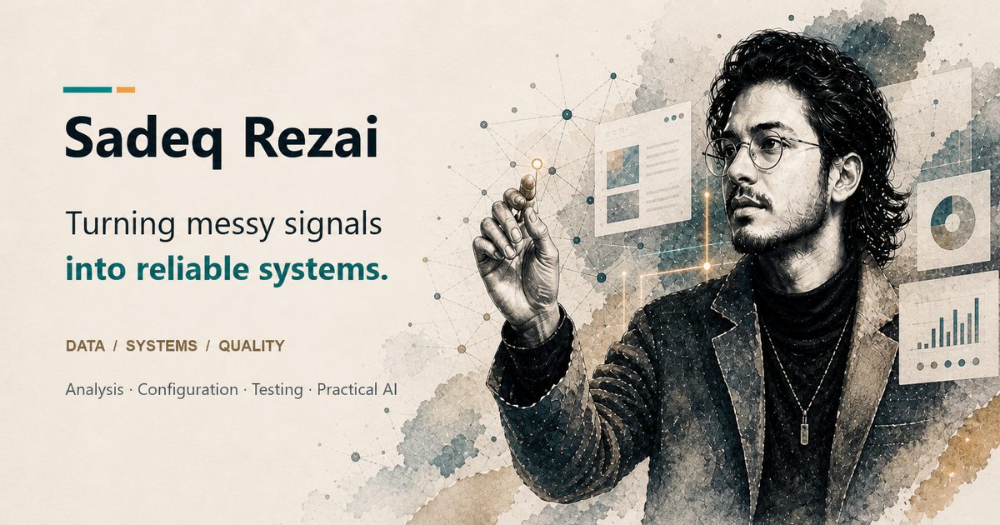
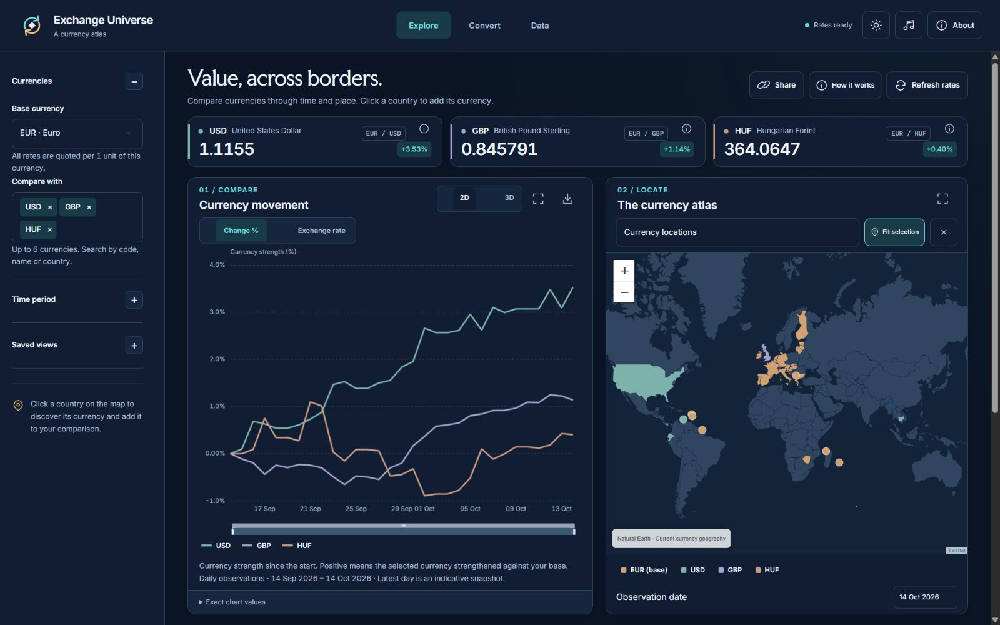
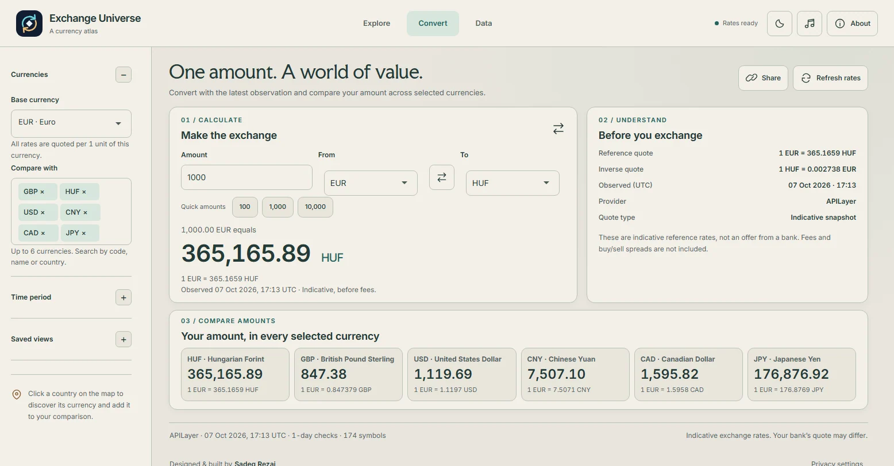
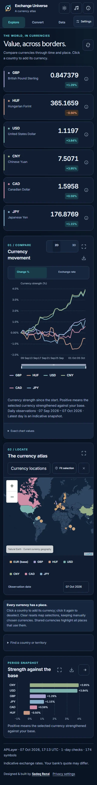

# Sadeq Rezai — The Working Studio

## Maps and remaining reading surfaces — 1 November 2026

Selected Work and About now use broad feathered reading shades instead of
rectangular masks behind individual text columns. The existing hero and footer
transitions, project cards and interactive depth field retain their owners.

The four interactive system maps add local `assets/map-motion.js` and
`assets/map-motion.css` through `tools/portfolio-theme-build.mjs`. Native SVG
packets, arrow cues and arrival rings follow the existing source-linked paths;
selected connections are brighter. This is explanatory animation, not live
traffic, provider activity or telemetry. Pause map motion is a separate named
control whose preference survives selection, visibility and reload. Native SVG
clocks pause offscreen, on hidden documents and page exit. Reduced motion keeps
the original static arrows and selection controls. No JavaScript frame loop,
network request or geometry rewrite is added. Script-free exports stay static.

Project introductions retain warm ivory/copper/sage accents in dark mode and
forest/copper in light mode. Tool panels have distinct raised headers and borders.
Guide panels name their automatic looping and manual Pause. All four existing
guide controllers retain indefinite cycles and explicit user pause, with temporary
offscreen/hidden suspension and reduced-motion stillness.

Run `node tools/check-map-motion.mjs` for directional path references, selection,
manual pause, reduced motion and native clock lifecycle checks, alongside the
existing four guide suites which exercise multiple complete cycles and held pauses.

## Homepage polish — 1 November 2026

The hero uses warm ivory or charcoal text with copper emphasis, a sage action
in dark mode and a restrained forest action in light mode.
The shared Balanced Studio palette now carries warm ivory, charcoal, copper and sage
through the surrounding pages, project surfaces, maps and guides. How I Work uses one broad radial reading shade with transparent
edges instead of rectangular heading/step masks. The shading is static and does
not filter or alter the 3D renderer.

The opening hero uses the available viewport below the sticky navigation. Its
film controls occupy a real layout row, with clearance for the optional assistant;
short desktop windows use a smaller headline. Narrow phones may grow naturally
instead of clipping their copy. The original native film timeline is unchanged.

Static gradient overlays at the start of Selected Work and the end of About
soften the transition into the interactive field and into the muted olive-charcoal contact area.
They add no scroll listener, rendering loop, blur animation or new dependency.
Projects retain opaque raised surfaces. How I Work uses a quieter divided sequence,
with tighter section spacing and headings aligned with the other sections.

Background intensity, Ripple and Pause previews now live in a native Display
disclosure. Pause background remains directly visible. Escape closes Display and
returns focus to its summary; clicking outside closes it too. Its controls do not
trigger background ripples. The phone assistant uses a 52px orb with its existing
accessible name. The Digital Twin CTA retains the semantic action foreground,
and the biography shows the confirmed FRAIA end date, September 2026.

## Balanced Studio palette — 1 November 2026

The background below the hero now uses a genuine Three.js perspective scene:
a continuous twisting particle ribbon plus particles distributed through depth.
The existing local Three.js r160 runtime is reused. The engine loads lazily when
the content enters view; it does not load the assistant or contact a provider.
The cursor changes the camera position, scene orientation and local ribbon depth.
Mouse/pen input stays enabled in narrow desktop windows, including MouseEvent-only
previews. Click or tap an empty area, or use the keyboard-accessible Ripple button,
to send a propagating deformation through the actual 3D geometry. Immersive mode
uses stronger camera movement and flowing depth particles; Calm softens both.
Immersive/Calm adjusts brightness and camera response, with a saved preference.

`assets/system-field.mjs` owns controls and visibility; `system-field-3d.mjs`
owns geometry, shaders and the renderer; `system-field-loop.mjs` owns the single
bounded render chain. Drawing is capped at 30 fps on desktop and 20 on phones,
with capped pixel ratio and smaller initial phone geometry. Those are configured
limits, not a hardware-performance benchmark. Pause preserves scene time;
offscreen/hidden/pagehide stops the loop. Reduced motion holds the 3D scene still.
Data Saver skips the 3D import, and unavailable WebGL gets an explicitly labelled
static fallback. The hero film and project preview controls retain their owners.

Run `node tools/check-system-field.mjs` for actual depth geometry, perspective,
camera response, shader uniforms and render-loop lifecycle checks.

Light mode uses warm ivory `#F3EFE6`, warm-charcoal text `#2A302D`, stone
project cards and copper emphasis `#965036`. Dark mode uses charcoal `#171D1B`
with a subtle green undertone, lighter warm-charcoal cards `#2C2E2A`, ivory text
and neutral secondary copy. Green is reserved for sage actions and selected
surfaces; copper remains the emphasis and interaction color. The ending uses a
muted olive-charcoal surface, cream copy and cream actions. The 3D field uses
desaturated stone/sage particles and copper highlights; geometry and motion are unchanged.
The same semantic roles drive project pages, map selection, controls and the
four-tone warm-metal guide solids. Contrast checks read the actual palette tokens.

Seneschal uses the user-selected Night Studio screenshot with the desktop mascot,
stored unchanged as `assets/seneschal-studio-20261101.png` (1919 × 1079).

`assets/palette-02.css` is the editable palette source. Run
`node tools/build-palette.mjs` to bundle it into the existing shared theme, then
`node tools/build-twin-case-integration.mjs` to refresh the separate Twin package.
Theme preference, motion controls and iframe selection remain unchanged.
The diagrams retain their original solids and motion; project screenshots, film
and brand mark retain their original colors. Historical notes below describe
earlier design revisions. No extra font, library or network request is introduced.


[Visit the portfolio](https://rammeshgar.github.io/)

An editorial, paper-cut portfolio focused on configuration and workflow validation, with supporting data products and practical AI work.



## Experience

- Responsive ivory, forest-green and copper design with project case studies.
- Compact introduction with direct selected-work, CV-request and contact actions. No public CV file is bundled; “Request CV” opens an email request.
- Early project index: Peoples Clinic QA Suite, Exchange Universe, then Seneschal. Each names the purpose, personal contribution and evidence available for inspection.
- Original artwork and muted film integrated across the opening, fading into the paper behind readable copy. Where native ViewTimeline is supported, scrolling advances the actual original movie; a visible control pauses scroll motion. Reduced-motion, Save-Data and unsupported browsers retain the artwork and controlled film fallback. The old 158-frame sequence is retained but never imported or warmed by the homepage.
- On-demand Three.js assistant with a paper-cut avatar, studio scene, blended gesture library, subtle torso and shoulder movement, and independent blinking.
- Text and voice interface, clear microphone invitation, speaker/mute controls and accessible focus states.
- Distinct email and copy-email actions; footer spacing accommodates the floating assistant.
- Three consistent cards link to dedicated case studies. QA, Exchange and Seneschal reveal their actual local teaching machines on hover or keyboard focus; the optional Digital Twin section has its own theatre preview and local case study. Each loads only on preview intent, only one can run at a time, and hidden/offscreen previews stop. A single Pause previews control sits above the cards, leaving all artwork unobstructed; case-study links still open in one tap. Each miniature keeps a short explanation and a model-driven step label. Save-Data disables preview loading. No live project or provider activity is represented as real data.
- [QA Suite](https://rammeshgar.github.io/qa-suite/), [Seneschal](https://rammeshgar.github.io/seneschal/) and [Digital Twin](https://rammeshgar.github.io/digital-twin/) each pair a source-linked architecture map with a distinct interactive physical metaphor. Both tools appear near the top, with full-size links and readable phone layouts. The QA schedule and suite count describe implementation, not measured business impact. Seneschal’s image is labelled as a product illustration. The original [live Twin demo](https://rammeshgar.github.io/digital-twin-demo/) remains separate.
- The optional digital-twin section includes assistant and background-music controls; neither is required to read the work or make contact.
- Larger secondary text, consistent project framing and theme-aware keyboard focus; the expanded mobile assistant keeps focus inside its fullscreen view.

## Exchange Universe case study

The dedicated [Exchange Universe case study](https://rammeshgar.github.io/exchange-universe/)
presents a source-linked **System map** and **Animated guide** together immediately
after its short introduction, with product evidence and contribution story below. Select one of seven
components to read its purpose, design decisions and exact GitHub source lines;
then play its related teaching example. The tools sit side by side on wider screens
and stack on phones, with readable local controls and permanent full-size links.

The guide loads when its panel becomes visible or a selection requests it; it stops
offscreen or when the document is hidden and never calls the rate provider. Existing
product screenshots and the project’s reliability/data limitations remain available.
See [implementation and review notes](docs/exchange-explainer.md) for the pinned
source, build steps, design receipt and verification scope.

[Live dashboard](https://sadeq.shinyapps.io/exchange_universe/) · [Source and documentation](https://github.com/Rammeshgar/Exchange_Universe_shiny)

### Rebuilt dashboard — October 2026



### Convert



<details>
<summary>Mobile dashboard</summary>



</details>

The main dashboard was captured from the published app on 14 October 2026. Convert
and mobile views are from the 7 October local review. Rates in screenshots are
snapshots, not current quotes. No API keys, private configuration or personal
correspondence are included.

## Running locally

Serve the repository with any static HTTP server. No frontend build is required.

The assistant uses the existing Netlify service. Its origin allowlist may reject localhost requests; live assistant testing must use the approved production origin. API secrets belong on the backend, never in this repository.

## Motion and performance

The avatar is loaded only when requested and targets 30 fps. Motion respects reduced-motion preferences. Gesture blending and breathing are implemented in `avatar/movement.mjs` and `avatar/presence.mjs`, not baked into every animation clip. The full-detail avatar is approximately 20.6 MB; performance depends on hardware and network conditions. Lip synchronization is approximate, not phoneme-perfect.

The current homepage uses `production.css`, `production.mjs`, `hero-scroll-native.mjs`,
`exchange-card-preview.mjs`, `assets/` and the
on-demand `avatar/` files. `hero-scroll.mjs` and `hero-frames/` are retained legacy
assets, not active entry-point dependencies.

## Evidence-first redesign preview

Prepared locally on 15 October 2026; this description is not confirmation of deployment.
The identity remains cream, forest green and copper, with local fonts and original artwork.
No new framework, service or package installation was introduced. Existing source links,
experience, languages, case-study dialogs and data/beta boundaries remain available.
The integrated-film revision uses one project overview and four project journeys.
Digital Twin keeps its existing canonical case in its separately deployed repository;
the newer `/digital-twin/` route is a compatibility alias. See
[guide design and evidence notes](docs/case-study-guides.md) and
[the two-repository delivery notes](docs/canonical-twin-delivery.md).

Focused checks:

```sh
node tools/build-twin-case-integration.mjs
node tools/check-portfolio.mjs
node tools/check-exchange.mjs
node tools/check-motion.mjs
node tools/check-qa-guide.mjs
node tools/check-seneschal-guide.mjs
node tools/check-twin-guide.mjs
node tools/check-preview-integration.mjs
node tools/check-delivery.mjs
node tools/check-theme.mjs
node --check production.mjs
```

These 144 focused checks cover structure, asset references, native progress and controlled
media lifecycle fixtures, parseable metadata, real guide transforms, concurrent panels
and the existing frame-origin/selection protections. They are
not a full accessibility, security, performance or live-backend audit.

See [original project-machine concepts, source pins and audit scope](docs/project-machines.md)
for reproducible builds and the distinction between model tests, geometry checks and browser review.

## Selected A layout and light/dark themes

The homepage uses the accepted paper/green/copper direction: a larger QA flagship,
then Exchange Universe and Seneschal. This hierarchy is a presentation choice,
not a claim that QA matters more than R work. The original scrolling film keeps
its existing composition, native timeline, decoder and controls. Actual machine
previews still load only on intent, with one owner and the shared Pause previews
control; no extra image-cover buttons were introduced.

The native header Theme control follows the operating system initially, then
remembers an explicit light/dark choice locally. It works across owned case pages
and their compact/full interactive maps and guides without clearing selection or
manual Pause. It has no service dependency. Storage denial degrades to a working
in-memory choice. Static/script-free and explicit light/dark export variants retain
their fixed palettes; print uses a light semantic palette rather than recolouring
screenshots or film. The original canonical Twin package carries its own theme
assets for independent delivery.

Local browser review covered 1440px desktop, 390px and 320px phone layouts, native
keyboard controls, reload/navigation persistence, real decoded film progress,
moving previews, and a paused/selected QA example surviving theme changes. Named
text/control contrast pairs passed focused checks. These observations are not a
full accessibility audit or a Lighthouse-score claim. No real audio, microphone,
assistant/provider, clinic check, commit, push or deployment was invoked.
