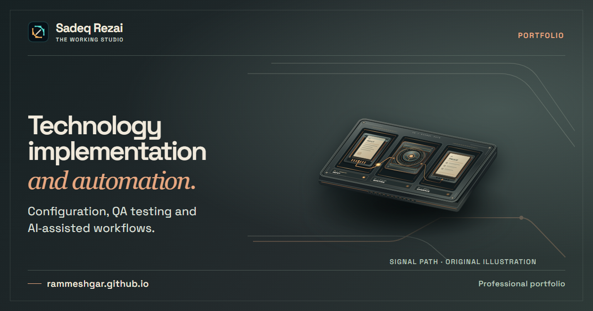

# Sadeq Rezai | The Working Studio

[Visit the portfolio](https://rammeshgar.github.io/) · [GitHub profile](https://github.com/Rammeshgar) · [LinkedIn](https://www.linkedin.com/in/sadeqrezai/)

I configure software, test browser and API behaviour, and build tools for working with data. This is my portfolio and the source code behind its interactive case studies. I use AI to help implement projects, while taking responsibility for requirements, integration and testing.



## Selected projects

| Case study | What it covers | Project or evidence |
| --- | --- | --- |
| [Exchange Universe](https://rammeshgar.github.io/exchange-universe/) | R/Shiny currency atlas with linked maps, history, conversion and data export. | [Live app](https://sadeq.shinyapps.io/exchange_universe/) · [Source](https://github.com/Rammeshgar/Exchange_Universe_shiny) |
| [Exchange Universe Monitor](https://rammeshgar.github.io/exchange-universe-monitor-case/) | Scheduled browser checks, conversion validation, run history, screenshots and email alert handling. | [Live monitor](https://rammeshgar.github.io/exchange-universe-monitor/) · [Source](https://github.com/Rammeshgar/exchange-universe-monitor) |
| [Seneschal](https://rammeshgar.github.io/seneschal/) | Windows/WSL workspace for coordinating AI-assisted tasks, dependencies, permissions and review. Public beta. | [Source and releases](https://github.com/Rammeshgar/seneschal) |
| [Interactive Digital Twin](https://rammeshgar.github.io/digital-twin/) | Portfolio assistant with text, optional voice, speech-driven animation and fallback behaviour. | [Standalone assistant](https://rammeshgar.github.io/digital-twin-demo/) · [Frontend](https://github.com/Rammeshgar/digital-twin-demo) · [AI service](https://github.com/Rammeshgar/mascot-backend) |
| [Afterlight](https://rammeshgar.github.io/afterlight-case/) | Animated, interactive pixel-art environments for Windows. | [Source and releases](https://github.com/Rammeshgar/afterlight) |
| [Peoples Clinic QA Suite](https://rammeshgar.github.io/qa-suite/) | Historical browser/API validation and monitoring work from my former role at FRAIA. The scheduled checks ended in November 2026. | [Archived dashboard](https://rammeshgar.github.io/PC-test-automation/) · [Source](https://github.com/Rammeshgar/PC-test-automation) |

## What is interactive

- The homepage's Three.js instrument illustrates three stages of a workflow: **Define, Connect and Verify**. Each can be selected with a visible control or by clicking the live model on supported devices.
- Project previews, source-linked system maps and animated guides explain selected implementation decisions. The illustrations are demonstrations, not live product activity or telemetry.
- Day and night themes, reduced-motion support, and pause controls are available. On narrow screens the opening illustration stays lightweight until 3D is requested or scrolled into view.
- The original film, background music and Digital Twin are optional. The assistant opens directly within the portfolio or its current case studies when requested. Its separately maintained app is also available standalone; neither the character nor an AI request starts on initial page load.

## Running locally

This is a static GitHub Pages site. No frontend build or API key is required to read the portfolio. From the repository root, serve the files with a static HTTP server:

```sh
python -m http.server 8080
```

Open `http://localhost:8080/`. To exercise the embedded assistant locally, serve the Digital Twin application from the same origin at `/digital-twin-demo/`. Live services have their own access requirements.

## Source layout

| Files | Responsibility |
| --- | --- |
| `index.html`, `studio-v3.css`, `studio-v3.mjs` | Homepage layout, theme, interactions and preview lifecycle. |
| `studio-v3-scene.mjs`, `studio-v3-field.mjs`, `assets/three.module.js` | Workflow instrument and animated contour fields. |
| `studio-case.css`, `studio-case.mjs`, `studio-v3-studies.css` | Shared case-study layout and interactions. |
| Individual case-study directories | Project content, guides and system maps. |
| `studio-extras.css`, `studio-extras.mjs` | Optional background music and original film. |
| `studio-assistant.css`, `studio-assistant.mjs` | Shared, on-request Digital Twin launcher, same-origin modal and cleanup lifecycle. |
| `assets/portfolio-analytics.js`, `robots.txt`, `sitemap.xml` | Shared analytics configuration and search discovery. |

The November 2026 redesign was published and checked against the live site. The final release audit passed 23 interaction checks, 83 deployment checks and both desktop and mobile Lighthouse accessibility, Best Practices and SEO audits. Lab performance scores were 98 on desktop and 99 on mobile; results vary with hardware and network conditions.

Analytics uses the existing GA4 and Microsoft Clarity setup, respects DNT/GPC, and does not initialize in local previews or embedded guides. The site does not include a private CV; the Request CV action opens an email request. Provider secrets belong on the backend.

Previous design revisions, including the earlier film-based homepage and guide build notes, are recorded in the [design history](docs/design-history-through-2026-11-07.md) and the other [project documentation](docs/).
