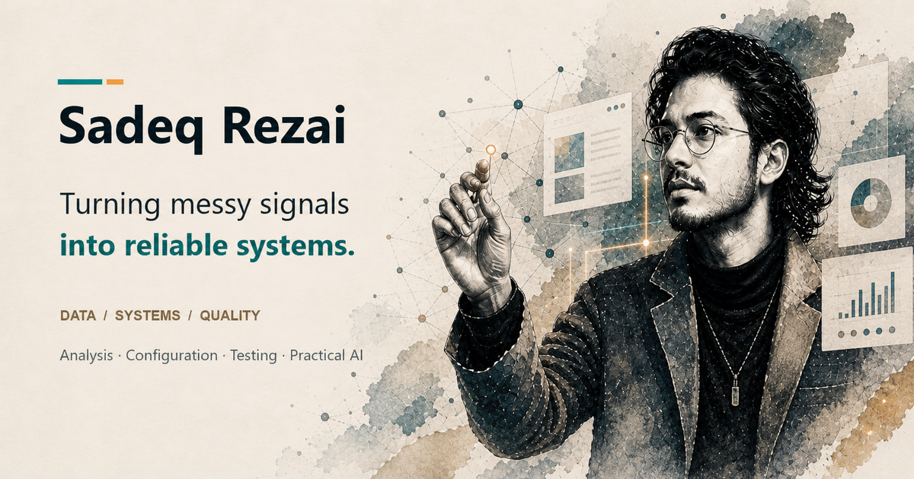
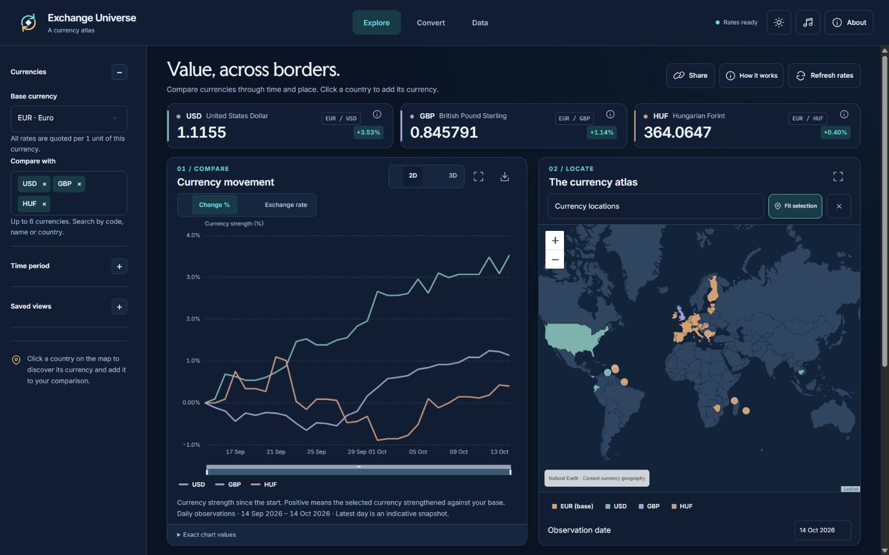
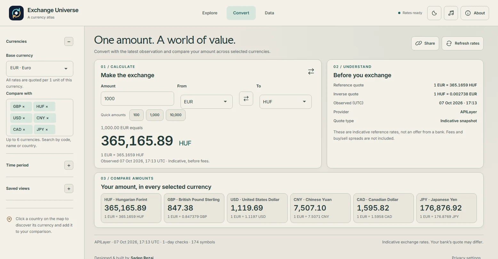
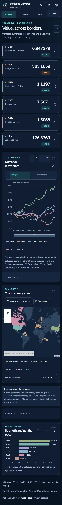

# Sadeq Rezai — The Working Studio

[Visit the portfolio](https://rammeshgar.github.io/)

An editorial, paper-cut portfolio focused on configuration and workflow validation, with supporting data products and practical AI work.



## Experience

- Responsive ivory, forest-green and copper design with project case studies.
- Compact introduction with direct selected-work, CV-request and contact actions. No public CV file is bundled; “Request CV” opens an email request.
- Early project index: Peoples Clinic QA Suite, Exchange Universe, then Seneschal. Each names the purpose, personal contribution and evidence available for inspection.
- Original artwork and muted film integrated across the opening, fading into the paper behind readable copy. Where native ViewTimeline is supported, scrolling advances the actual original movie; a visible control pauses scroll motion. Reduced-motion, Save-Data and unsupported browsers retain the artwork and controlled film fallback. The old 158-frame sequence is retained but never imported or warmed by the homepage.
- On-demand Three.js assistant with a paper-cut avatar, studio scene, blended gesture library, subtle torso and shoulder movement, and independent blinking.
- Text and voice interface, clear microphone invitation, speaker/mute controls and accessible focus states.
- Distinct email and copy-email actions; footer spacing accommodates the floating assistant.
- Three consistent cards link to dedicated case studies. QA, Exchange and Seneschal reveal their actual local teaching machines on hover or keyboard focus; the optional Digital Twin section has its own theatre preview and local case study. Each loads only on preview intent, only one can run at a time, and hidden/offscreen previews stop. A single Pause previews control sits above the cards, leaving all artwork unobstructed; case-study links still open in one tap. Each miniature keeps a short explanation and a model-driven step label. Save-Data disables preview loading. No live project or provider activity is represented as real data.
- [QA Suite](https://rammeshgar.github.io/qa-suite/), [Seneschal](https://rammeshgar.github.io/seneschal/) and [Digital Twin](https://rammeshgar.github.io/digital-twin/) each pair a source-linked architecture map with a distinct interactive physical metaphor. Both tools appear near the top, with full-size links and readable phone layouts. The QA schedule and suite count describe implementation, not measured business impact. Seneschal’s image is labelled as a product illustration. The original [live Twin demo](https://rammeshgar.github.io/digital-twin-demo/) remains separate.
- The optional digital-twin section includes assistant and background-music controls; neither is required to read the work or make contact.
- Larger secondary text, consistent project framing and theme-aware keyboard focus; the expanded mobile assistant keeps focus inside its fullscreen view.

## Exchange Universe case study

The dedicated [Exchange Universe case study](https://rammeshgar.github.io/exchange-universe/)
presents a source-linked **System map** and **Animated guide** together immediately
after its short introduction, with product evidence and contribution story below. Select one of seven
components to read its purpose, design decisions and exact GitHub source lines;
then play its related teaching example. The tools sit side by side on wider screens
and stack on phones, with readable local controls and permanent full-size links.

The guide loads when its panel becomes visible or a selection requests it; it stops
offscreen or when the document is hidden and never calls the rate provider. Existing
product screenshots and the project’s reliability/data limitations remain available.
See [implementation and review notes](docs/exchange-explainer.md) for the pinned
source, build steps, design receipt and verification scope.

[Live dashboard](https://sadeq.shinyapps.io/exchange_universe/) · [Source and documentation](https://github.com/Rammeshgar/Exchange_Universe_shiny)

### Rebuilt dashboard — October 2026



### Convert



<details>
<summary>Mobile dashboard</summary>



</details>

The main dashboard was captured from the published app on 14 October 2026. Convert
and mobile views are from the 7 October local review. Rates in screenshots are
snapshots, not current quotes. No API keys, private configuration or personal
correspondence are included.

## Running locally

Serve the repository with any static HTTP server. No frontend build is required.

The assistant uses the existing Netlify service. Its origin allowlist may reject localhost requests; live assistant testing must use the approved production origin. API secrets belong on the backend, never in this repository.

## Motion and performance

The avatar is loaded only when requested and targets 30 fps. Motion respects reduced-motion preferences. Gesture blending and breathing are implemented in `avatar/movement.mjs` and `avatar/presence.mjs`, not baked into every animation clip. The full-detail avatar is approximately 20.6 MB; performance depends on hardware and network conditions. Lip synchronization is approximate, not phoneme-perfect.

The current homepage uses `production.css`, `production.mjs`, `hero-scroll-native.mjs`,
`exchange-card-preview.mjs`, `assets/` and the
on-demand `avatar/` files. `hero-scroll.mjs` and `hero-frames/` are retained legacy
assets, not active entry-point dependencies.

## Evidence-first redesign preview

Prepared locally on 15 October 2026; this description is not confirmation of deployment.
The identity remains cream, forest green and copper, with local fonts and original artwork.
No new framework, service or package installation was introduced. Existing source links,
experience, languages, case-study dialogs and data/beta boundaries remain available.
The integrated-film revision uses one project overview and four project journeys.
Digital Twin keeps its existing canonical case in its separately deployed repository;
the newer `/digital-twin/` route is a compatibility alias. See
[guide design and evidence notes](docs/case-study-guides.md) and
[the two-repository delivery notes](docs/canonical-twin-delivery.md).

Focused checks:

```sh
node tools/build-twin-case-integration.mjs
node tools/check-portfolio.mjs
node tools/check-exchange.mjs
node tools/check-motion.mjs
node tools/check-qa-guide.mjs
node tools/check-seneschal-guide.mjs
node tools/check-twin-guide.mjs
node tools/check-preview-integration.mjs
node tools/check-delivery.mjs
node tools/check-theme.mjs
node --check production.mjs
```

These 144 focused checks cover structure, asset references, native progress and controlled
media lifecycle fixtures, parseable metadata, real guide transforms, concurrent panels
and the existing frame-origin/selection protections. They are
not a full accessibility, security, performance or live-backend audit.

See [original project-machine concepts, source pins and audit scope](docs/project-machines.md)
for reproducible builds and the distinction between model tests, geometry checks and browser review.

## Selected A layout and light/dark themes

The homepage uses the accepted paper/green/copper direction: a larger QA flagship,
then Exchange Universe and Seneschal. This hierarchy is a presentation choice,
not a claim that QA matters more than R work. The original scrolling film keeps
its existing composition, native timeline, decoder and controls. Actual machine
previews still load only on intent, with one owner and the shared Pause previews
control; no extra image-cover buttons were introduced.

The native header Theme control follows the operating system initially, then
remembers an explicit light/dark choice locally. It works across owned case pages
and their compact/full interactive maps and guides without clearing selection or
manual Pause. It has no service dependency. Storage denial degrades to a working
in-memory choice. Static/script-free and explicit light/dark export variants retain
their fixed palettes; print uses a light semantic palette rather than recolouring
screenshots or film. The original canonical Twin package carries its own theme
assets for independent delivery.

Local browser review covered 1440px desktop, 390px and 320px phone layouts, native
keyboard controls, reload/navigation persistence, real decoded film progress,
moving previews, and a paused/selected QA example surviving theme changes. Named
text/control contrast pairs passed focused checks. These observations are not a
full accessibility audit or a Lighthouse-score claim. No real audio, microphone,
assistant/provider, clinic check, commit, push or deployment was invoked.
